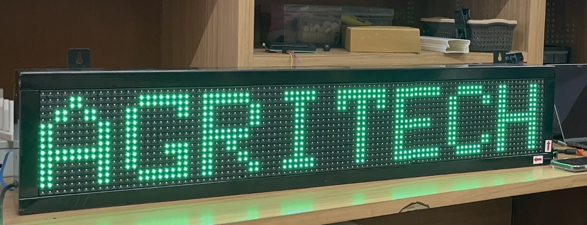

# AgriTech Clock

An ESP32-S2 weather clock for the AgriTech club at MITWPU Pune, running on a Huidu WF1 controller and three P10 RGB LED panels.

Displays local time, weather and a Pune air-quality estimate. Wi-Fi reconnects automatically; no weather API key is required for the configured Open-Meteo service. Wi-Fi credentials must be configured before the first build. Brightness is **155/255**.

## Display cycle

| Page | Duration |
| --- | --- |
| Time (IST, HH:MM:SS) | 5 seconds |
| Temperature, UV index, PUNE AQI, visibility | 5 seconds each |
| Humidity (% RH), feels like, wind, precipitation | 5 seconds each |
| Sea-level pressure, PM2.5, weather condition | 5 seconds each |
| AgriTech / MITWPU Pune | 5 seconds |
| Wi-Fi status / local IP address | 2 seconds |

The full cycle takes 67 seconds after a 5-second startup title. S1 advances to the next page. API status and attribution stay in the documentation and serial diagnostics.

## Hardware tested

- Huidu **WF1 v7.0.1-1**, ESP32-S2 revision 0, 4 MB flash, no PSRAM.
- Three **P10-32X16-3535-8S-M1**, 32×16 RGB, 1/8-scan HUB75 panels, chained horizontally for **96×16**.
- External regulated **5 V / 20 A** supply; 4.98 V measured at the furthest panel on this installation.

These are HUB75 RGB panels. Other WF1 revisions, scan patterns and WF2 controllers require separate verification.

## Build in VS Code / PlatformIO

Install the PlatformIO IDE extension in VS Code, open this folder and use the PlatformIO build/upload controls, or run:

```sh
python3 -m pip install platformio==6.2.0
cp include/secrets.h.example include/secrets.h
# Edit include/secrets.h with your 2.4 GHz Wi-Fi credentials.
pio run
```

Read [wiring and photos](docs/HARDWARE.md) and [download mode / flashing](docs/FLASHING.md) before uploading. The controller's Micro-USB connector is power-only. The native USB-A connection and UART are different programming paths.

```sh
pio device list
# Enter ROM download mode first; use your actual port.
pio run -t upload --upload-port /dev/cu.usbmodem01
pio device monitor --port /dev/cu.usbmodem01 --baud 115200
```

Uploads attempt a full flash backup first and abort if backup fails. See the flashing guide for the explicit backup-skip option and recovery steps. Never publish secrets.h, backups or compiled binaries: they can contain credentials.

## Weather and air quality

The configured point is near MITWPU Pune: **18.5177° N, 73.8150° E**. Requests refresh every 5 minutes; failed requests retry after 60 seconds. Current weather and hourly UV/visibility are model data, not an on-campus sensor. The last complete snapshot is cached in flash; stale values show `*` (weather after 30 minutes, air after 2 hours). Missing data shows `--`.

`PUNE AQI` uses an **Indian CPCB breakpoint calculation applied to modeled pollutant data**. It is not an official Pune city/station AQI reading. The implementation uses 24-hour means of available PM2.5, PM10, NO2, SO2 and NH3, requires at least 16 samples per included pollutant, at least three pollutants and a particulate pollutant. CO, ozone and lead are omitted. Above the bounded Severe threshold it displays `401+`, not an invented exact value. See [implementation notes](docs/DEVELOPMENT.md).

## Documentation

- [Controller, panel connections, USB and UART photos](docs/HARDWARE.md)
- [Backup, ROM download mode, flashing and normal restart](docs/FLASHING.md)
- [Troubleshooting ports, blank display, HTTP -1 and flicker](docs/TROUBLESHOOTING.md)
- [Memory, cache, AQI tests and development](docs/DEVELOPMENT.md)
- [Credits and data attribution](CREDITS.md)

## Validation

The deployed firmware was built and flashed with esptool hash verification. Weather and air requests were observed succeeding on hardware after the RAM fix; a runtime sample showed 87,792 bytes free heap, 29.4 °C, UV 7.1 and modeled Pune AQI 73. The owner confirmed stable panel operation. The public package has a separate build check and native AQI tests; see VALIDATION.md. No original stock firmware backup is included.

## License

GPL-3.0-only; see [LICENSE](LICENSE). Dependencies retain their own licenses. Hardware photos were supplied by the project owner for this documentation. This project is independent of Huidu, MITWPU and the data providers.
