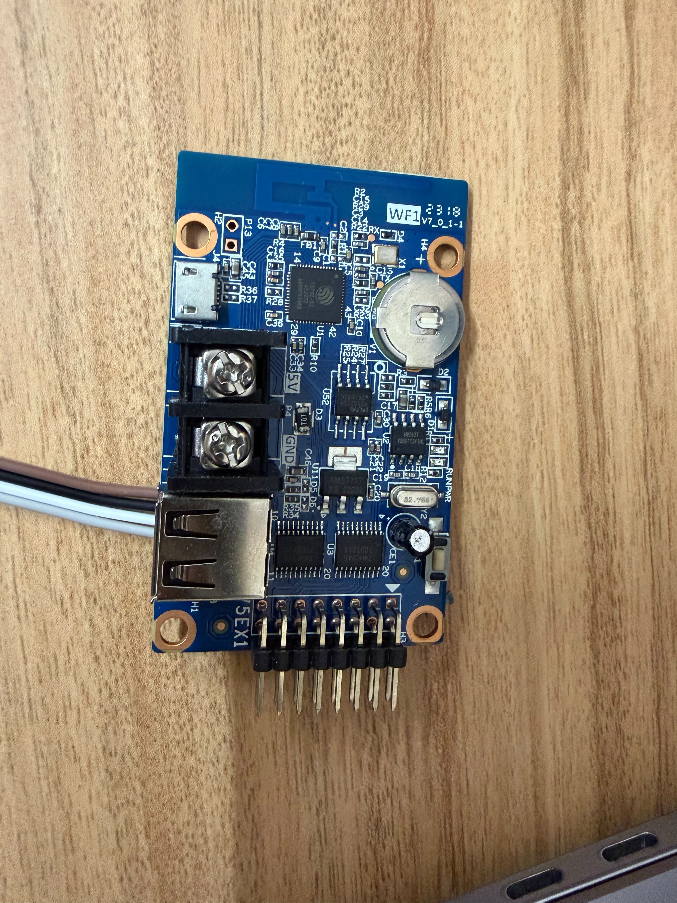
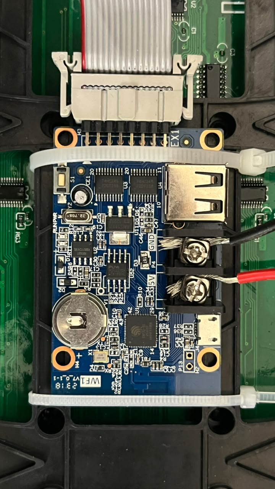
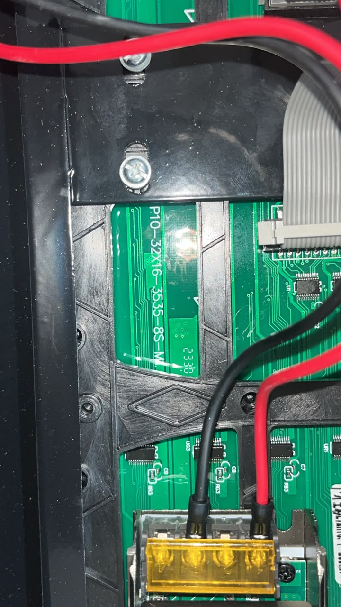
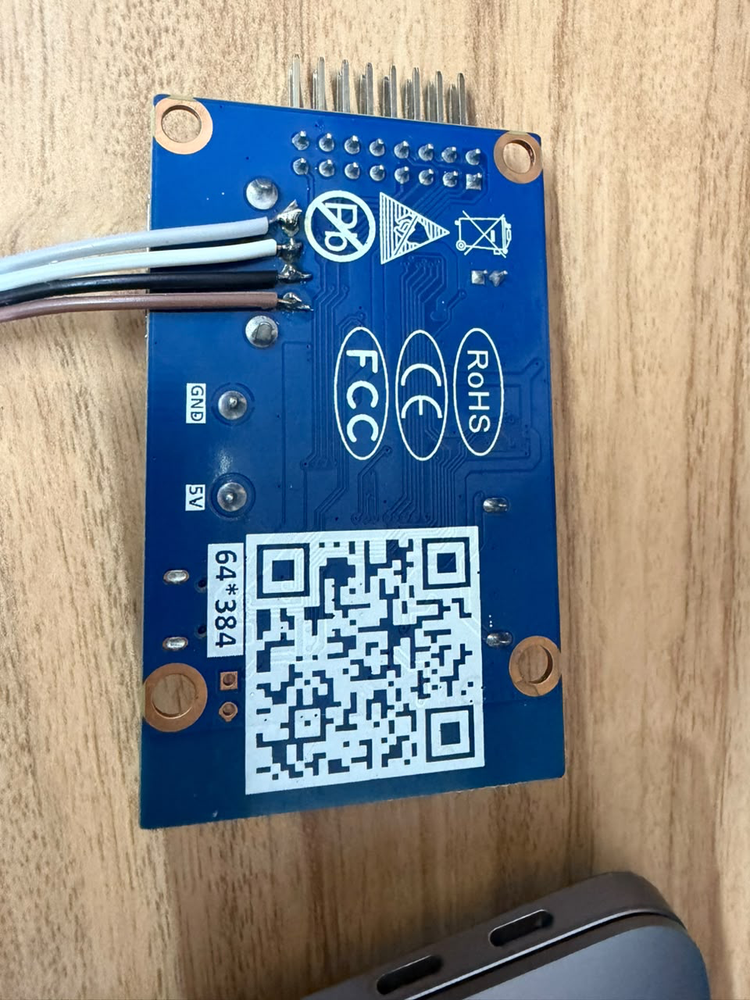
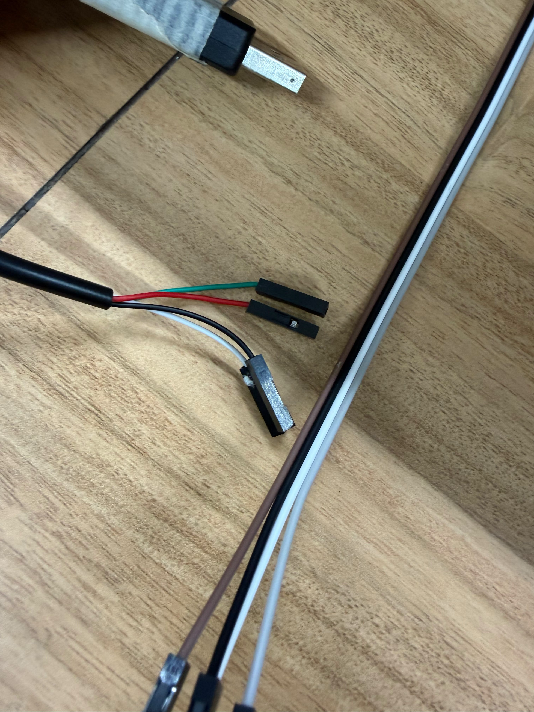
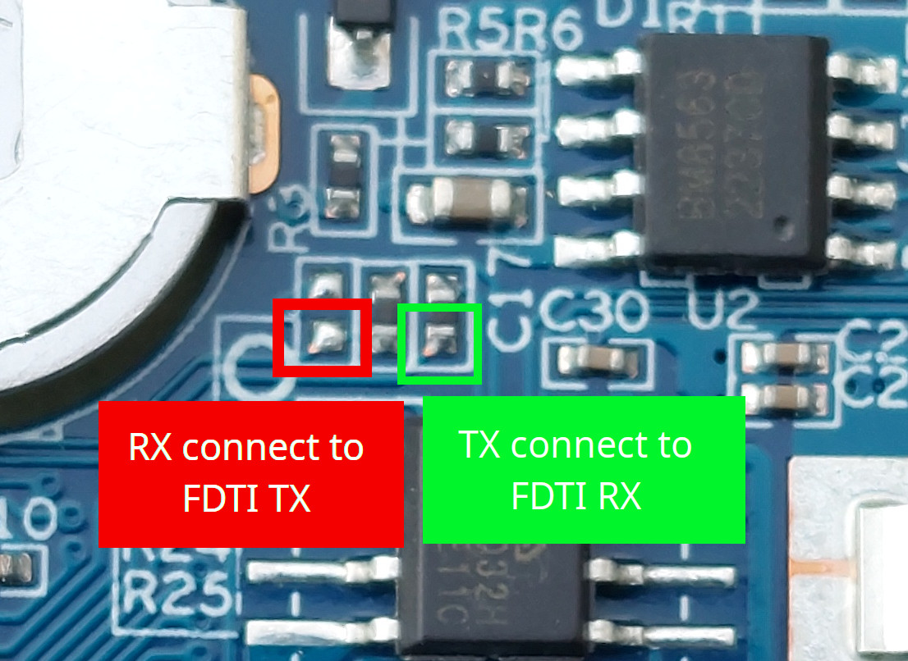

# Hardware and wiring

## Identify the board before soldering

The tested controller is WF1 v7.0.1-1 with an ESP32-S2, not a WF2. On the component-side photo below, P13/H2 is beside the Micro-USB connector at the upper left. Gold RX and TX test pads are labeled beside the coin-cell holder. The two screw terminals are explicitly labeled 5V and GND. S1 is a display/test button, not BOOT.



## Panel and power wiring

Connect WF1's 75EX1 HUB75 output to the first panel's INPUT. Chain its OUTPUT to the second INPUT, then the third. All panels face the same way and form one 96×16 row. Follow connector keys and board arrows rather than guessing from ribbon color.

Feed each panel and the controller from the external regulated 5 V supply with appropriate wire size and secure terminals. Share ground. The ribbon is for signals, not panel power. Keep power leads short, insulate exposed joints, add strain relief and route them clear of sharp edges. Disconnect power before changing connections. Do not work on the mains side of the supply.





## Native USB programming

The WF1 **Micro-USB is power-only**. On the tested board, the large USB-A socket provides the native ESP32-S2 USB data connection. ESP32-S2 native USB is D− = GPIO19, D+ = GPIO20.

A raw USB cable carries VBUS, D−, D+ and GND. A USB-to-UART adapter carries TXD/RXD instead; those signals cannot substitute for D+/D−.

| Computer USB signal | Controller signal |
| --- | --- |
| D+ | USB D+ / GPIO20 |
| D− | USB D− / GPIO19 |
| GND | GND |
| VBUS +5 V | Leave isolated when powering the board externally |

Do not connect the dock's +5 V rail to the external supply's +5 V rail through a homemade cable. A generic USB-A to USB-A cable may connect both power rails; verify/isolate VBUS before using it with an externally powered controller.

### Underside soldering photo



With this photo oriented exactly as shown (HUB header above, QR label below), the four soldered wires from top to bottom are gray, white, black and brown. Their **inferred** socket order is GND, D+, D−, VBUS. This mapping was inferred from connector orientation; it was not established by electrical measurements. **Verify every signal using a multimeter and the connector contact numbering before connecting a computer.** Other board revisions or viewing angles may reverse apparent order.

Disconnect USB, external power and the coin cell before continuity measurements. Verify ground against the labeled GND terminal. Identify each socket contact using a known USB breakout or connector datasheet, then trace it to its solder joint. Confirm no bridges between adjacent joints or between VBUS and ground. Insulate unused VBUS at both ends.



Common USB colors are red = VBUS, black = GND, green = D+, white = D−, but cable colors do not prove function. In particular, a USB-to-serial cable can use similar colors for UART signals. Do not connect cables by matching colors between these photos.

## UART alternative: CP2102 USB-to-serial programmer

Use a CP2102 adapter with **3.3 V UART logic**. Connect the CP2102's USB socket to the computer and wire its serial pins to these WF1 pads:



In the close-up **as oriented above**, the red box marks **board RX** (left, beside the battery), and the green box marks **board TX** (right, below C17). The boxes identify solder pads, not components to remove. The image's “FDTI” text refers to a USB-to-UART programmer; the same crossed TX/RX connections apply to a CP2102.

| CP2102 adapter pin | Connect to WF1 |
| --- | --- |
| **TXD / TX** | **RX — red-boxed pad** in the close-up |
| **RXD / RX** | **TX — green-boxed pad** in the close-up |
| **GND** | **Labeled GND screw terminal** (the external supply's negative/common ground) |
| **VCC / 5V / 3V3** | **Leave disconnected** while the WF1 uses its external 5 V supply |
| **DTR / RTS**, if exposed | Leave disconnected for this manual boot procedure |

The CP2102 USB connection powers the adapter; the external 5 V supply powers the WF1 and panels. Share GND between them. Verify the adapter's TX logic level before connecting it: a 3V3/5V power pin or jumper does not necessarily change UART signal voltage. Never apply 5 V to board RX/TX. USB D+/D− are separate signals and are not used for this UART connection.

Solder with USB and external power disconnected, inspect for bridges, then insulate and strain-relieve the wires. Use pad labels and the photo rather than wire colors.

For UART flashing, enter [P13/H2 ROM download mode](FLASHING.md#enter-rom-download-mode) with both power sources fully disconnected first, then reconnect with the boot bridge in place. Select the **CP2102 adapter's serial port**, not a native USB port:

```sh
pio device list
# macOS example only; substitute the actual CP2102 port.
pio run -t upload --upload-port /dev/cu.SLAB_USBtoUART
```

Other CP2102 port names include `/dev/cu.usbserial...` on macOS, `/dev/ttyUSB0` on Linux or `COM3` on Windows. Wait for hash verification. Remove the boot bridge with power off and restart normally. The build's application diagnostics use **native USB CDC**; the CP2102 is the ROM flashing connection and will not automatically receive those application logs. Use the native USB data connection for the serial diagnostics described in the flashing guide.

Photo reference: [mrcodetastic's annotated WF1 UART pads](https://github.com/mrcodetastic/HD-WF1-WF2-LED-MatrixPanel-DMA/blob/cee182159dc6b2c08fd088ca068f8ea58af79b88/wf1_pcb_pins_2.jpg), supplied here by the project owner; upstream GPL-3.0. See [credits](../CREDITS.md).

## HUB75 GPIO map

These are already routed on the WF1 PCB; no extra MCU wiring is needed for the onboard HUB connector.

| Signal | GPIO | Signal | GPIO |
| --- | --- | --- | --- |
| R1 | 2 | R2 | 4 |
| G1 | 6 | G2 | 8 |
| B1 | 3 | B2 | 5 |
| A | 39 | B | 38 |
| C | 37 | LAT | 33 |
| OE | 35 | CLK | 34 |
| S1 | 11 | D / E | Unused |

Pin mapping reference: [mrcodetastic WF1 configuration](https://github.com/mrcodetastic/HD-WF1-WF2-LED-MatrixPanel-DMA/blob/cee182159dc6b2c08fd088ca068f8ea58af79b88/src/wf1wf2demo/hd-wf1-esp32s2-config.h). Physical photos are installation references, not a substitute for continuity testing.
